# 🌟 LumiStay Hotel & Resort

**Website khách sạn & nghỉ dưỡng 5 sao có đặt phòng trực tuyến và trợ lý ảo Lumi**

Tìm phòng · Đặt phòng tính tiền tự động · Tra cứu bằng mã · Đánh giá · Bảng thống kê quản trị

---

## Mục lục

1. [Giới thiệu](#1-giới-thiệu)
2. [Tính năng nổi bật](#2-tính-năng-nổi-bật)
3. [Vai trò người dùng](#3-vai-trò-người-dùng)
4. [Kiến trúc hệ thống](#4-kiến-trúc-hệ-thống)
5. [Các luồng hoạt động](#5-các-luồng-hoạt-động)
6. [Hạn chế và hướng phát triển](#6-hạn-chế-và-hướng-phát-triển)

---

## 1. Giới thiệu

**LumiStay** là website cho một khách sạn nghỉ dưỡng 5 sao (mẫu: 120 phòng, Nha Trang), thiết kế sang trọng với vàng kim, xanh hải quân ban đêm và hiệu ứng kính mờ. Hệ thống phục vụ trọn vòng đời của một đơn đặt phòng:

- **Khách** xem phòng, lọc theo hạng và giá, đặt phòng không cần tài khoản, tra lại đơn bằng mã và hỏi trợ lý ảo.
- **Thành viên** xem lại các đơn của mình và huỷ đơn.
- **Quản trị viên** duyệt đơn, xác nhận thanh toán, quản lý phòng, dịch vụ, đánh giá và xem thống kê doanh thu.

> Trợ lý **Lumi** hiện trả lời theo **từ khoá có sẵn** (giá phòng, giờ nhận/trả, dịch vụ, chính sách huỷ…), chưa gọi mô hình ngôn ngữ.

## 2. Tính năng nổi bật

**Khách tham quan**
- Trang chủ: hero hoàng hôn, thanh đặt phòng nhanh, giới thiệu, phòng nổi bật dạng carousel, dịch vụ 5 sao, đánh giá khách hàng.
- Danh mục phòng có bộ lọc theo hạng phòng, khoảng giá, từ khoá; trang chi tiết có bộ ảnh, tiện nghi, chính sách nhận/trả phòng.
- Đặt phòng ngay trong cửa sổ đặt phòng: **tiền tính tự động theo số đêm × giá phòng**, chọn phương thức thanh toán.
- Mã đặt phòng sinh tự động, **tra cứu đơn chỉ bằng mã**.
- Trợ lý Lumi nổi ở góc màn hình, trả lời 24/7 về giá phòng, dịch vụ, bữa sáng, nhận phòng.

**Quản trị**
- Thống kê tổng đơn, đơn chờ duyệt, đơn đã xác nhận và doanh thu.
- Duyệt đơn qua nhiều trạng thái, xác nhận thanh toán, huỷ đơn.
- Quản lý hạng phòng, dịch vụ; duyệt và ghim đánh giá nổi bật.

## 3. Vai trò người dùng

| Vai trò | Quyền chính |
| --- | --- |
| Khách | Xem phòng, đặt phòng, tra cứu đơn bằng mã, hỏi trợ lý, gửi đánh giá |
| Thành viên | Xem đơn của mình, huỷ đơn |
| Quản trị viên | Toàn bộ đơn, thanh toán, phòng, dịch vụ, đánh giá, thống kê |

## 4. Kiến trúc hệ thống

> Các sơ đồ bên dưới là ảnh SVG động: chấm sáng chạy dọc mũi tên theo từng bước, node được tô sáng khi dữ liệu tới.

## 5. Các luồng hoạt động

### 5.1. Khách đặt phòng và tra cứu đơn

Hệ thống kiểm tra phòng còn nhận khách, tính số đêm (phải từ 1 đêm trở lên), nhân với giá phòng ra tổng tiền, lưu đơn ở trạng thái chờ duyệt rồi trả mã để khách tra cứu.

### 5.2. Vòng đời một đơn đặt phòng

Đơn đi qua chờ duyệt → đã xác nhận → đang lưu trú → đã trả phòng, và có thể bị huỷ ở các bước đầu. Thanh toán theo dõi riêng (chưa thanh toán → đã thanh toán → hoàn tiền).

### 5.3. Đánh giá phòng và điểm trung bình

Mỗi khi có đánh giá mới, hệ thống gom các đánh giá đã duyệt của đúng phòng đó, tính trung bình rồi cập nhật điểm và số lượt đánh giá của phòng. Chỉ đánh giá đã được admin duyệt mới hiện ra website.

### 5.4. Bảng thống kê của quản trị

Doanh thu chỉ cộng các đơn **đã thanh toán và chưa bị huỷ**, nên số liệu phản ánh tiền thực thu.

## 6. Hạn chế và hướng phát triển

- Trợ lý Lumi khớp từ khoá, chưa dùng AI thật; có thể nối mô hình ngôn ngữ và dữ liệu phòng thật.
- Đặt phòng chưa kiểm tra trùng lịch giữa các đơn cùng phòng, cùng ngày.
- Thanh toán mới ghi nhận phương thức, chưa có cổng thanh toán hay xác nhận tự động.
- Chưa có kiểm thử tự động.
