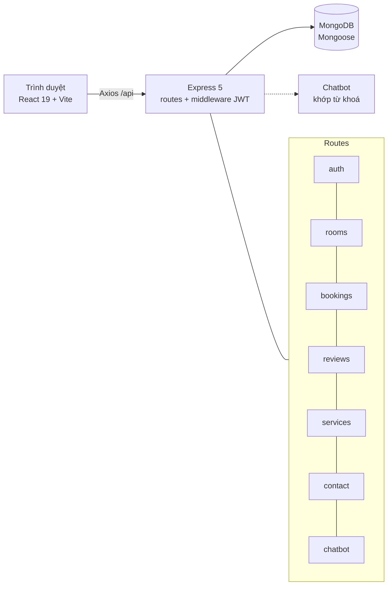
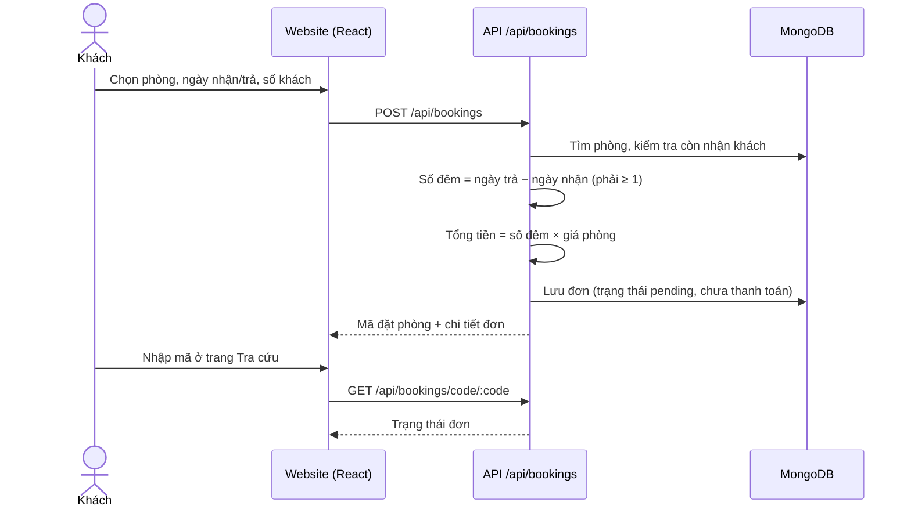
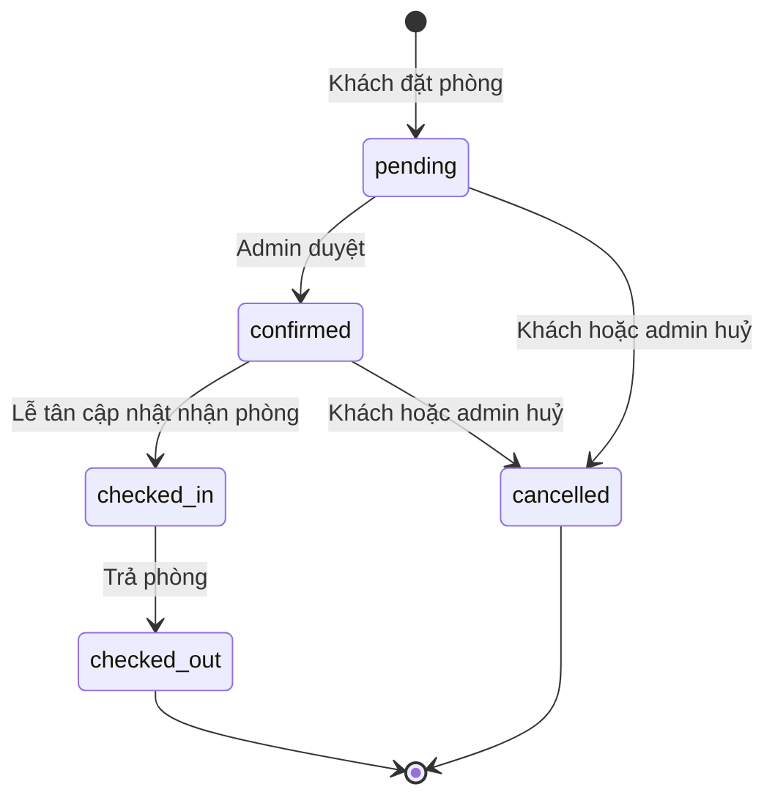
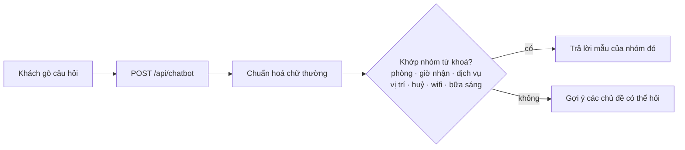
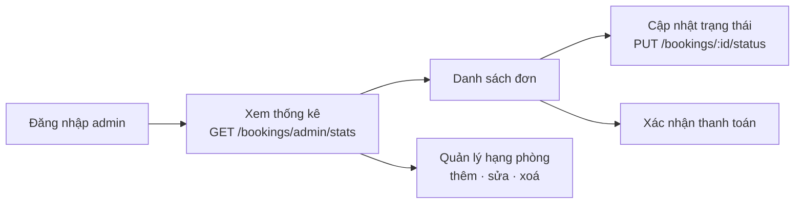
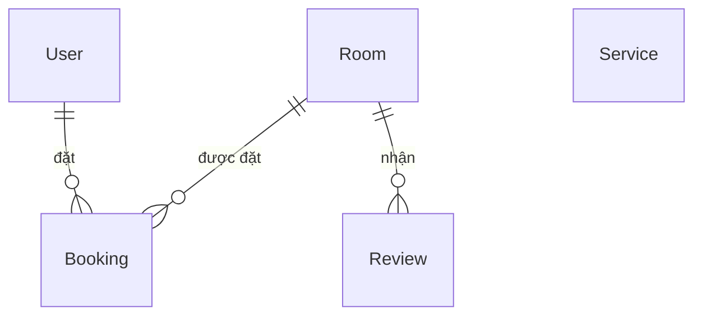

<div align="center">

# 🌟 LumiStay Hotel & Resort

**Website khách sạn & nghỉ dưỡng 5 sao có đặt phòng trực tuyến và trợ lý ảo Lumi**

Tìm phòng · Đặt phòng tính tiền tự động · Tra cứu bằng mã · Quản trị đơn & phòng


</div>

---

## Mục lục

1. [Giới thiệu](#1-giới-thiệu)
2. [Tính năng nổi bật](#2-tính-năng-nổi-bật)
3. [Vai trò người dùng](#3-vai-trò-người-dùng)
4. [Kiến trúc hệ thống](#4-kiến-trúc-hệ-thống)
5. [Các luồng hoạt động](#5-các-luồng-hoạt-động)
6. [Mô hình dữ liệu](#6-mô-hình-dữ-liệu)
7. [Bản đồ đường dẫn và API](#7-bản-đồ-đường-dẫn-và-api)
8. [Hạn chế và hướng phát triển](#8-hạn-chế-và-hướng-phát-triển)
9. [Chi tiết cài đặt và chạy](#9-chi-tiết-cài-đặt-và-chạy)

---

## 1. Giới thiệu

**LumiStay** là website cho một khách sạn nghỉ dưỡng 5 sao (mẫu: 120 phòng, Nha Trang). Giao diện theo phong cách sang trọng: vàng kim, xanh hải quân ban đêm, hiệu ứng kính mờ. Hệ thống phục vụ trọn vòng đời của một đơn đặt phòng:

- **Khách** xem phòng, lọc theo hạng/giá, đặt phòng không cần tài khoản, tra lại đơn bằng mã và hỏi trợ lý ảo.
- **Thành viên** đăng ký/đăng nhập để xem lại các đơn của mình và huỷ đơn.
- **Quản trị viên** duyệt đơn, xác nhận thanh toán, quản lý phòng và xem doanh thu.

> Trợ lý **Lumi AI** hiện trả lời theo **từ khoá có sẵn** (giá phòng, giờ nhận/trả, dịch vụ, chính sách huỷ…), chưa gọi mô hình ngôn ngữ.

## 2. Tính năng nổi bật

**Khách tham quan**
- Trang chủ: hero hoàng hôn, thanh đặt phòng nhanh (ngày nhận/trả, số khách), giới thiệu, phòng nổi bật dạng carousel, dịch vụ 5 sao, đánh giá khách hàng.
- Danh mục phòng có bộ lọc theo hạng phòng, khoảng giá, từ khoá; trang chi tiết có bộ ảnh, tiện nghi, chính sách nhận/trả phòng.
- Đặt phòng ngay trong modal: **tiền tính tự động theo số đêm × giá phòng**, chọn phương thức thanh toán (chuyển khoản, tiền mặt tại quầy, thẻ).
- Mã đặt phòng sinh tự động, **tra cứu đơn chỉ bằng mã**, không cần đăng nhập.
- Liên hệ, đánh giá và chatbot Lumi nổi ở góc màn hình.

**Thành viên**
- Đăng ký, đăng nhập (JWT), cập nhật hồ sơ, xem "Đơn của tôi", tự huỷ đơn.

**Quản trị**
- Thống kê tổng đơn, doanh thu, đơn chờ duyệt.
- Duyệt đơn qua các trạng thái, xác nhận thanh toán, huỷ đơn.
- Thêm/sửa/xoá hạng phòng, dịch vụ, duyệt hoặc xoá đánh giá.

## 3. Vai trò người dùng

| Vai trò | Khu vực | Quyền chính |
| --- | --- | --- |
| Khách (chưa đăng nhập) | `/`, `/rooms`, `/rooms/:id`, `/booking-lookup`, `/contact` | Xem phòng, đặt phòng, tra cứu đơn bằng mã, hỏi chatbot |
| Thành viên | `/my-bookings`, hồ sơ | Xem đơn của mình, huỷ đơn |
| Quản trị viên | `/admin` | Mọi đơn, trạng thái thanh toán, phòng, dịch vụ, đánh giá, thống kê |

Phân quyền ở backend bằng middleware `protect` (đã đăng nhập) và `authorize('admin')`.

## 4. Kiến trúc hệ thống



Luồng thường gặp: **Trang React → `utils/api.js` (Axios) → route Express → model Mongoose → JSON trả về**. Token JWT lưu ở phía trình duyệt và gửi kèm các API cần đăng nhập.

## 5. Các luồng hoạt động

### 5.1. Khách đặt phòng và tra cứu đơn



### 5.2. Vòng đời một đơn đặt phòng



Thanh toán theo dõi riêng: `unpaid → paid → refunded`; phương thức gồm `cash`, `card`, `transfer`, `online`.

### 5.3. Hỏi trợ lý Lumi



### 5.4. Quản trị viên xử lý đơn



## 6. Mô hình dữ liệu



| Bảng (collection) | Nội dung chính |
| --- | --- |
| `User` | Tài khoản thành viên/admin, mật khẩu băm bcrypt |
| `Room` | Tên, hạng, giá/đêm, diện tích, số khách, ảnh, tiện nghi, còn nhận khách |
| `Booking` | Phòng, khách, ngày nhận/trả, số đêm, tổng tiền, trạng thái, thanh toán, yêu cầu đặc biệt |
| `Review` | Đánh giá của khách, admin duyệt/xoá |
| `Service` | Dịch vụ tiện ích của khách sạn |

## 7. Bản đồ đường dẫn và API

| Khu vực | Đường dẫn | Chức năng |
| --- | --- | --- |
| Công khai | `/` · `/rooms` · `/rooms/:id` | Trang chủ, danh mục, chi tiết phòng |
| | `/booking-lookup` · `/contact` | Tra cứu đơn, liên hệ |
| | `/login` · `/register` | Xác thực |
| Thành viên | `/my-bookings` | Đơn của tôi |
| Admin | `/admin` | Bảng điều khiển |

| Nhóm API | Điểm cuối chính |
| --- | --- |
| Xác thực | `POST /api/auth/register` · `POST /api/auth/login` · `GET /api/auth/me` · `PUT /api/auth/profile` |
| Phòng | `GET /api/rooms` · `GET /api/rooms/:id` · `POST/PUT/DELETE` (admin) |
| Đặt phòng | `POST /api/bookings` · `GET /api/bookings/code/:code` · `PUT /api/bookings/:id/cancel` · `PUT /api/bookings/:id/status` (admin) · `GET /api/bookings/admin/stats` (admin) |
| Khác | `/api/reviews` · `/api/services` · `/api/contact` · `POST /api/chatbot` |

## 8. Hạn chế và hướng phát triển

- Chatbot khớp từ khoá, chưa dùng AI thật; có thể nối API mô hình ngôn ngữ và dữ liệu phòng thật.
- Đặt phòng **chưa kiểm tra trùng lịch** giữa các đơn cùng phòng, cùng ngày.
- Thanh toán chỉ ghi nhận phương thức, **chưa có cổng thanh toán** hay xác nhận tự động.
- Chưa có kiểm thử tự động.

---

## 9. Chi tiết cài đặt và chạy

## 🔑 Tài Khoản Admin Mặc Định

- **Email**: `admin@lumistay.com`
- **Mật khẩu**: `admin123456`

---

## 💻 Hướng Dẫn Chạy Dự Án

### 1. Khởi động Backend
```bash
cd backend
npm install
npm start
# Backend chạy tại: http://localhost:5001
```

### 2. Khởi động Frontend
```bash
cd frontend
npm install
npm run dev
# Frontend chạy tại: http://localhost:5173
```
